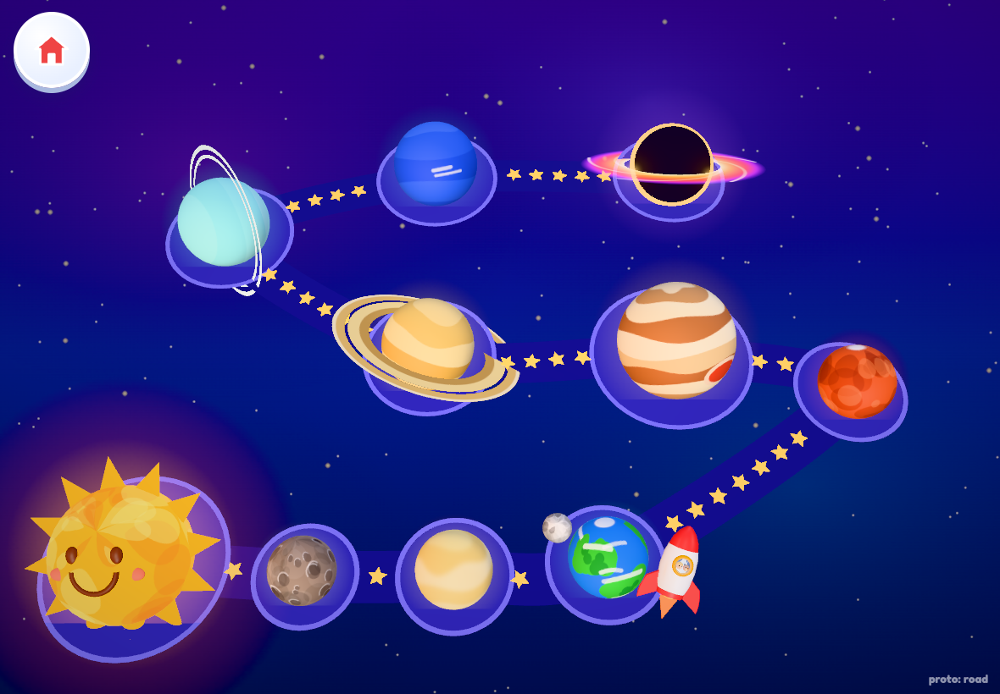

# Rocket and space plan

Zosia taps a rocket on the island, counts down with Chase and flies to a space map. The map is a road of stars from
the Sun past every planet, and beyond it the far-away places (a black hole, comets, the stars). Every stop shows what
the place looks like and says one or two true things about it. Most stops also have a short game built on a skill the
game already teaches, plus one new skill, knowing the places themselves. Phase 1 makes the trip and three games
playable. Phases 2 and 3 add a game at each remaining stop.

## 0. What this plan stands on

- **A prototype.** Two layouts of the map, drawn in the game's style, on the local branch `proto/space-map` (10b9f6e).
  Screenshots are `docs/space/road.png` and `docs/space/orbit.png`. Open it with `#space-road` or `#space-orbit`.
- **Checked facts.** Every fact below comes from NASA, ESA, Polish Wikipedia or Wiktionary pages read for this plan
  (sources at the end). Moon counts that change over time are left out.
- **A map of the code.** Where a second area attaches, with file and line pointers (section 5).

## 1. A trip, step by step

1. A rocket stands on its own launch pad on the island. She taps it, the cruiser drives over, and Zosia and Chase put
   on helmets and climb in.
2. The countdown. "Pięć, cztery, trzy, dwa, jeden, start!" Big numerals light up one by one and she taps START herself.
3. Lift-off. The island shrinks, the rocket goes through the clouds, and Earth appears as a ball. "To nasza Ziemia!"
4. The space map. The rocket waits by Earth and the island's bouncing star marks a suggested stop. She can tap any
   stop. The rocket flies along the road and names each planet it passes ("Mijamy Marsa!"), so she hears the order of
   the planets on every flight.
5. Arrival. The place fills the screen and turns slowly. Chase says what it is and one true thing about it ("To jest
   Saturn. Saturn ma wielkie pierścienie."). A stop with a game starts it. A stop without one lets her tap the place to
   hear more, and the rocket waits.
6. After a game comes the usual celebration, then "Lecimy dalej czy do domu?" Earth on the map is the way home, and the
   rocket lands on the island.
7. When the session wants the finale, or she is tired, Chase says "Wracamy do domu!" and the rocket flies back. The
   finale and the goodnight stay on the island, as today.

## 2. What she learns, and what we leave out

**New, knowing the places.** She recognises the Sun, the Moon, the planets, a comet and the black hole, the same way
she learns letters. First she matches a picture, then she finds a place by its name, then by a feature ("Która planeta ma
pierścienie?"). A later level, for age 4 to 5, asks the order ("Co jest po Marsie?"), which every flight has already
been naming.

**Skills she already has, in a new place.**

- **Counting.** Jumps on the Moon, space rocks for the black hole, craters on Mercury.
- **Numerals.** The countdown, and the Mars rover driving to a numbered rock.
- **Number order.** Joining stars 1, 2, 3 until a picture lights up.
- **Letters.** Comets flying past with letters on them.
- **Patterns.** Jupiter's stripes.
- **Sorting.** Ice and rock for Saturn's rings.
- **Big and small.** Only where the gap is huge (Jupiter and Earth, the Sun and Earth).

**Left out on purpose** (research, section 10):

- How the Moon's shapes or day and night happen. Explanations wait until 4 to 5.
- Size questions on near-equal pairs (Earth and Venus, Uranus and Neptune).
- Telling Uranus from Neptune by colour. NASA says the famous deep-blue Neptune is bluer than the real one.
- Moon counts for the giant planets, which keep changing.
- "Closer means hotter." Mercury is closest to the Sun, but Venus is the hottest.
- The Sun "going to sleep" or "hiding". Young children already think of the Sun as alive.
- The black hole as a monster, a vacuum cleaner or a tunnel. It is shown from far away, and nothing she loves goes in.
- Pluto as a planet. It is "planeta karłowata".
- One-word voice clips. The fallback voice could read "Mars" in English, so every line is a sentence ("To jest Mars.").

## 3. The places

Every place is a stop she can visit from phase 1, with its look and its facts. The game column says what she plays there
and in which phase it arrives.

| Place | Facts she hears | Game (skill) | Built like | Phase |
|---|---|---|---|---|
| Ziemia | "To nasza Ziemia." "Na Ziemi jest dużo wody." | none, it is the way home | | 1 |
| Księżyc | "Księżyc świeci światłem Słońca." "Księżyc widać też w dzień." | Moon jumps. "Skocz trzy razy!" She taps Chase, he floats up and down slowly, and each jump leaves a footprint in a row. Later, "Ile było skoków?" (counting) | Treat House | 1 |
| Czarna dziura | "Czarna dziura mocno przyciąga." "Jest bardzo, bardzo daleko." | From the rocket's window she lets space rocks go, one at a time. They swirl in and the ring glows brighter. "Ile skał wpadło?" (counting) | Treat House | 1 |
| Teleskop, in the rocket | none | "Gdzie jest Saturn?" A picture to match, then a name, then a feature, then the order (new skill `space`) | Kitty Park | 1 |
| Słońce | "Słońce to gwiazda." "Nie patrzymy prosto na Słońce." | none. Chase puts on sunglasses and the rocket stays far away | | 1 |
| Uran | "Uran toczy się jak piłka." | none. It rolls when she taps it | | 1 |
| Neptun | "Neptun jest najdalej od Słońca." "Tu wieją najmocniejsze wiatry." | none. The wind blows when she taps it | | 1 |
| Saturn | "Saturn ma wielkie pierścienie." "Są z lodu i skał." | Mending the rings. Ice goes to one ring and rock to the other (sorting) | Garage blocks | 2 |
| Jowisz | "Jowisz to największa planeta." "Czerwona plama to wielka burza." | Painting the stripes, which one comes next (patterns). "Który jest większy?" Jupiter or Earth (big and small) | Garage flags | 2 |
| Mars | "Mars jest czerwony jak rdza." "Mars ma dwa małe księżyce." | The rover drives to the rock with the right numeral (numerals) | Cone Road | 2 |
| Kometa | "Kometa to kula lodu i pyłu." "Ogon rośnie blisko Słońca." | Comets fly past with letters. Tap the one with Be (letters) | Balloon Hill | 2 |
| Gwiazdy | "Wielki Wóz to siedem gwiazd." | Join the stars 1, 2, 3 and a picture lights up, a rocket or a pup. The top level is the Wielki Wóz (number order) | new, small | 2 |
| Merkury | "Merkury jest najbliżej Słońca." "To najmniejsza planeta." | How many craters, at a glance (counting) | Treat House "Szybkie oko" | 3 |
| Wenus | "Wenus to najgorętsza planeta." | The clouds part over a shape. Which one is it? (shapes) | Garage door | 3 |
| Pluton | "Pluton to planeta karłowata." "Pluton ma jasne serduszko." | Find the heart among the shapes (shapes) | Garage door | 3 |

## 4. The space map is a road of stars

The prototype drew two layouts at iPad size (1180 × 820). The road wins.

| | Road | Orrery (planets circling the Sun) |
|---|---|---|
| Smallest stop on screen (Mercury) | 81 px | 79 px |
| Draw calls, at the medium setting | 68 | 65 |
| Order she can follow | one path from the Sun outward | none; neighbours sit on opposite sides of the Sun |
| Where to tap | every stop has its own glowing disc | the planet itself |

Both are about a tenth of the island's cost (648 draw calls), because space has no shadows and about 50 objects.

Changes from the prototype:

- The black hole, comets and stars move to a far-away part past Neptune and Pluto, reached by a longer flight ("Lecimy
  daleko, daleko!"). In the prototype the black hole sits right after Neptune, which says it is part of our solar
  system.
- The Moon becomes its own stop next to Earth.
- The suggested stop gets the island's bouncing star, and the rocket flies along the road to the stop she taps.
- A wider view for 4:3 iPads, where the Sun's rays are cut off at 1366 × 1024.
- A brighter road. It is faint against the sky.
- The map has its own row of stars for each stop. The island's badge shelf gets a single rocket badge, because ten more
  badges would not fit.

## 5. How it fits the game

This section is for whoever builds it.

- **One list of places first.** Today a new mission touches ten separate lists (main.js:58, parse.js:14, levels.js:41,
  ui.js:8, hub.js:35 and :141, pl.js:48 and :78, director.js:18, world.js:29), and nothing checks that they agree. A missed
  entry crashes only during play (levels.js:56 on a gentler run, ui.js:35 at the celebration). Fold them into
  `src/places.js`, a pure module with a test that every place has every field. Seven to fifteen space places would
  otherwise cost about a hundred scattered edits.
- **The way home remembers where she came from.** `game.home()` goes back to the map that started the mission. Three call
  sites change, hold-to-leave (mission.js:56), the celebration and its auto-return (mission.js:129), and closing the
  parent page (main.js:36).
- **The space map is a second stage**, `src/scenes/space.js`, loaded only when she boards the rocket, so the island
  starts as fast as today.
- **Space games are ordinary missions** with tables in GAME.md. Levels, badges, mastery and the session count come with
  that. Look-only stops are a small stage that never counts as a mission.
- **The director runs on the map too.** The map calls `suggestNext` with the space kinds. When the finale is due or she is
  tired, it flies home first, because `suggestNext` returns nothing for the finale without the Lookout in its list
  (director.js:139).
- **Saves.** Mission levels need no migration (`missions` is open-ended). A list of visited places is a new field, so it
  needs a v6 step and a test.
- **Keepsakes.** Each place she visits leaves a small model around the launch pad. Reveals stay on the island, because
  `takeUnseen` empties every pending reveal at once (rewards.js:29).
- **Drawing.** No shadows in space and no point light for the Sun. The Sun's glow is a sprite, because the low setting has
  no bloom. The black hole gets a glowing disc, not a full-screen lensing pass. The map stays under 100 draw calls. A
  slow space scene could lock the whole game at medium quality (post.js:138).
- **Voice.** About 40 lines for the map and the flights, and 40 to 60 per game. Phase 1 is about 250 clips, roughly
  5 MB more in the offline copy. Planet names get sampled on the main voice and listened to before the full recording.
- **Tools.** The walker learns a whole trip (island, rocket, map, stop, home) and the look-only stops, which it cannot
  play today. The learning simulator gains the new kinds (the Garage is missing there too).

## 6. Order of work

Each unit ends in a check, and the next one starts only after it passes. Every game unit also gets a GAME.md table and
unit tests for its level rules.

**Phase 1, the trip and three games.**

1. **One list of places.** The check. All tests pass, plus a new test that every place has every field. All 76 levels replay
   to the celebration as before, and an island screenshot matches today's.
2. **The way home remembers.** The check. A unit test covers the origin, and island missions still return to the island.
3. **The rocket on the island, the countdown, lift-off and the flight to the map.** The check. The launch pad's tap target
   measures at least 70 px, the walker reaches the map, and there is a screenshot of each beat.
4. **The space map with every look-only stop, the suggested stop and the way home.** The check. The walker visits every stop
   and lands back home with 0 page errors. The smallest stop is at least 70 px at both iPad sizes, and the map draws
   under 100 calls. A finale or a tired session forced from the parent page flies her home.
5. **Moon jumps.** The check. The walker plays every level to the celebration, with screenshots.
6. **The black hole.** The check. The same, and the parent looks at the screenshots and a short video for anything scary.
7. **The telescope and the new `space` skill**, with a section on the parent page. The check. Tests cover the new skill. The
   guesser simulation shows random tapping does not look like knowing.
8. **Voices, an old save, and the update path.** The check. `npm run check` reports 0 unrecorded lines. Last week's save opens
   with the island intact. The update simulation finishes with the bigger offline copy.
9. **Deploy.** The parent runs `vercel deploy --prod`.

**Phase 2.** Saturn, Jupiter, Mars, comets and stars, one unit each, with the same checks as unit 5.

**Phase 3.** Mercury, Venus, Pluto, and keepsakes around the launch pad. Then a night sky with the Moon and the Wielki Wóz
at the goodnight, and home tasks such as "Poszukajcie dziś Księżyca na niebie!"

## 7. Decisions for the parent

Each has a default, which I will use unless you say otherwise.

1. **The map layout.** Default, the road. The orrery is the other option.
2. **The Sun's face.** The prototype's Sun smiles. Young children already think of the Sun as alive, so the default is a
   plain warm glow. Keeping the smile is a one-line change.
3. **Which games come first.** Default, Moon jumps, the black hole and the telescope. If she has a favourite planet, its
   game can move into phase 1.
4. **Free choice in space.** Default, every stop is open from the first trip and suggestions never lock anything, as on
   the island. The other option is stops that open one by one, outward from Earth.
5. **Where the rocket stands.** Default, the one free spot on the island, behind the Lookout on the left. If its tap
   target measures under 70 px there, the rocket gets its own small rock in the sea.
6. **A planet song.** The songs Polish preschools use are under copyright. Default, our own short chant on the flight
   that names the planets in order.

## 8. What I would not do

- **Real sizes and distances.** Mercury would be a dot and the map would not fit on a screen.
- **Steering the rocket by hand.** At 3, steering frustrates more than it teaches. A tap chooses where to go.
- **A lensing effect for the black hole.** It costs a full-screen pass for a picture she won't miss.
- **One island badge per space place.** The shelf has room for about two more.
- **Explaining the Moon's shapes or day and night now.** A later telescope level can, at 4 to 5.

## 9. Risks

- **A scary black hole or a dark sky.** The sky stays bright violet, the black hole is always seen from far away, and
  the parent reviews it before it ships (unit 6).
- **The finale due while she is in space.** The director has no answer there today. The rocket flies home first, and
  unit 4 tests it.
- **A bigger update.** About 5 MB more to download. The start paw waits at most 20 s and then plays the version already
  on the iPad, so a slow download costs one session, not a broken game.
- **The quality setting.** A slow space scene could lower quality on the island too. Space stays under its budget.
- **Mercury and the Moon look alike.** The prototype fixed it by colour (Mercury warm brown, the Moon nearly white). Unit 4
  keeps them apart.

## 10. Sources

Facts checked for this plan (all read on 2026-10-30):

- Sun, Mercury, Venus, Earth, Mars, Jupiter, Saturn, Uranus, Neptune facts, `https://science.nasa.gov/<planet>/facts/`
- Pluto, https://science.nasa.gov/dwarf-planets/pluto/facts/
- The Moon by day, https://www.nasa.gov/feature/episode-19-we-asked-a-nasa-scientist-why-can-you-see-the-moon-during-the-day
- Comets, https://spaceplace.nasa.gov/comets/en/
- Black holes for children, https://www.nasa.gov/learning-resources/for-kids-and-students/what-is-a-black-hole-grades-k-4/
- The asteroid belt and the Wielki Wóz, https://pl.wikipedia.org/wiki/Pas_planetoid and https://pl.wikipedia.org/wiki/Wielki_Wóz_(asteryzm)
- Polish forms (na Wenus, na Merkurym), https://pl.wiktionary.org/wiki/Wenus and https://pl.wiktionary.org/wiki/Merkury
- What 4 to 6 year olds remember about day and night, Kallery 2011, https://kallery.webpages.auth.gr/kalleryastroijse2011.pdf
- Common space misconceptions, Allen 2010, https://wordpressua.uark.edu/scimap/?p=547
